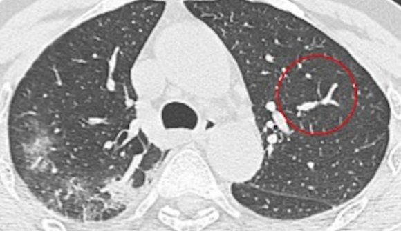
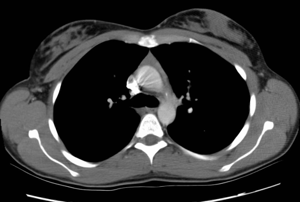
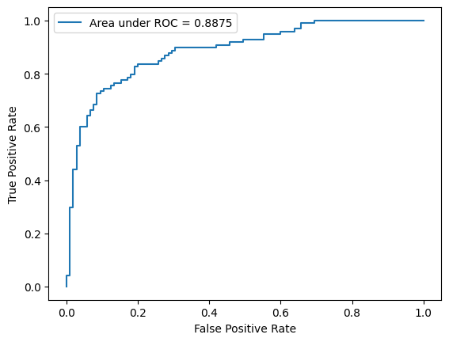
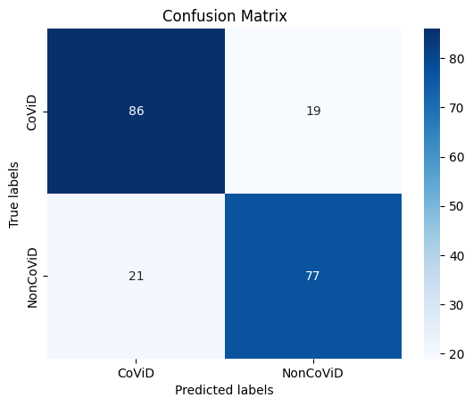

# CNN-Based Medical Image Diagnosis: COVID-19 CT Classification

본 Repository는 LAIDD '의료이미지 기반 환자진단 및 바이오마커 탐색' 과정의 실습 결과물을 정리한 프로젝트입니다. 합성곱 신경망(CNN)을 활용하여 COVID-19 및 Non-COVID CT 이미지를 분류하는 워크플로우를 구현하였습니다.

## 1. 프로젝트 및 데이터 개요
* **데이터셋:** COVID-CT-Dataset (A CT Image Dataset about COVID-19).
* **데이터 전처리:** 이미지를 224x224 해상도로 조정 및 정규화(Normalize)하였으며, 학습 데이터에는 RandomResizedCrop 및 RandomHorizontalFlip 기법을 적용하여 데이터 증강(Data Augmentation)을 수행하였습니다.

### CT 이미지 데이터 예시 (Sample Data)
| COVID-19 CT | Non-COVID CT |
| :---: | :---: |
|  |  |
| 실제 코로나19 양성 환자의 CT 흉부 이미지 | 정상(음성) 환자의 CT 흉부 이미지 |

---

## 2. 모델 아키텍처 및 실습 워크플로우

본 실습은 모델의 구조를 점진적으로 개선하는 3단계의 파이프라인으로 구성되어 있습니다.

### Step 1. Baseline Model (`1_1_Covid19_CT_CustomCNN_Baseline.ipynb`)
* COVID-19 CT 이미지 분류를 위한 초기 기준점(Baseline) 모델 환경 및 전처리 과정을 구축하였습니다.

### Step 2. Deeper Residual CNN (`1_2_Covid19_CT_DeeperResCNN_Improvement.ipynb`)
* **잔차 연결(Residual Block):** 네트워크 깊이에 따른 학습 저하를 방지하기 위해 Skip Connection을 도입하였습니다.
* **전역 평균 풀링(Global Average Pooling):** 공간 해상도를 1x1로 압축하는 `AdaptiveAvgPool2d`를 적용하여 파라미터 수를 128개로 줄이고 과적합을 방지하였습니다.
* **하이퍼파라미터 튜닝:** `Optuna` 라이브러리를 활용하여 학습률(Learning Rate), 가중치 감쇠(Weight Decay), 드롭아웃(Dropout) 비율을 최적화하였습니다.
* **조기 종료(Early Stopping):** 검증 손실(Validation Loss)을 기준으로 모델 학습을 조기 종료하는 로직을 적용하였습니다.

### Step 3. Feature Fusion Network (`1_3_Covid19_CT_FeatureFusion_Final_Pipeline.ipynb`)
* **특징 융합(Feature Fusion):** 대규모 데이터로 사전 학습된 `ResNet50` 모델과 맞춤형 특징 추출기(`CustomFeatureExtractor`)를 결합한 `CombinedCovidNet`을 설계하였습니다.
* **분류기 구조:** ResNet50의 특징 2048개와 맞춤형 모델의 특징 128개를 병합(`torch.cat`)하여 총 2176개의 특징 벡터를 구성한 뒤 최종 분류기(`Linear`)에 입력되도록 처리하였습니다.
* **학습 및 튜닝:** `Optuna`의 `MedianPruner`를 활용해 10회의 모의 탐색을 진행하여 하이퍼파라미터를 찾고, 이를 바탕으로 최대 30 에포크(Patience 10) 동안 최종 학습을 수행하였습니다.

---

## 3. 평가 결과 및 분석 (Evaluation)

### 평가 결과 시각화 (Result Visualization)

| ROC Curve | Confusion Matrix |
| :---: | :---: |
|  |  |
| **ROC AUC = 0.8874** 위양성률(FPR) 대비 진양성률(TPR) 성능 곡선 | **정확도 80.3% / 민감도 81.9%** 모델의 실제 예측과 정답 대조 히트맵 |

### 3.1. 평가지표 (Metrics)
최종 모델(`CombinedCovidNet`)을 테스트 데이터셋으로 평가한 결과는 다음과 같습니다.
* **검증(Validation) 성능:** 정확도(Accuracy) 80.3%, 민감도(Sensitivity) 78.6%, 특이도(Specificity) 81.9%, ROC Score 0.887.
* **테스트(Test) 성능:** 정확도 80.3% 수준을 유지하였으며, 테스트 셋의 실제 코로나 환자 105명 중 86명을 정확히 분류하여 민감도 81.9%, 특이도 78.6%를 기록하였습니다.

### 3.2. 혼동 행렬 (Confusion Matrix)
테스트 셋에 대한 혼동 행렬 판정 건수는 다음과 같습니다.
* **진양성 (TP, True Positive):** 86건 (코로나 환자를 코로나로 진단).
* **진음성 (TN, True Negative):** 77건 (정상인을 정상으로 진단).
* **위양성 (FP, False Positive):** 21건 (정상인에게 코로나로 오진).
* **위음성 (FN, False Negative):** 19건 (코로나 환자를 정상으로 오진).

### 3.3. 한계점 및 향후 개선 방향
* 융합 모델 적용을 통해 두 클래스에 대한 예측 균형이 안정화되었습니다.
* 하지만 의료 진단 데이터의 특성상 위음성(False Negative, 19건)은 질병을 놓치는 치명적인 지표입니다.
* 이를 개선하기 위해 모델의 분류 임계값(Threshold)을 현행 50%에서 30%~40% 수준으로 하향 조정하여, 민감도를 더욱 높이고 위음성 비율을 낮추는 후처리 기법 적용이 요구됩니다.

---

## 4. 2강. 대장암 조직 Patch 분류 모델 (`2강_1_colon_cancer_patch_model.ipynb`)

### 4.1. 데이터셋
* **주 학습 데이터셋:** Kather texture 2016 image tiles (5,000장, 각 150×150 픽셀 / 74×74 µm 크기의 대장암 조직 H&E 염색 patch), Zenodo(record 53169)에서 다운로드. 클래스당 500장을 학습(train), 나머지를 검증(validation)으로 분할하여 사용.
* **조직 클래스 (8종):** `01_TUMOR`, `02_STROMA`, `03_COMPLEX`, `04_LYMPHO`, `05_DEBRIS`, `06_MUCOSA`, `07_ADIPOSE`, `08_EMPTY`.
* **확장 실험 데이터셋:** 노트북 후반부에는 대규모 외부 데이터셋인 `NCT-CRC-HE-100K`(학습용, 약 100,000장)와 `CRC-VAL-HE-7K`(외부 검증용, 약 7,180장)(Zenodo record 1214456)를 추가로 활용하여, 9개 조직 클래스(`ADI`/`BACK`/`DEB`/`LYM`/`MUC`/`MUS`/`NORM`/`STR`/`TUM`) 체계로 재학습·재검증하는 별도 실험 블록이 포함되어 있음.

### 4.2. 모델 구축 목적
* ImageNet으로 사전 학습된 `ResNet50`의 마지막 fully-connected layer를 교체(전이 학습, transfer learning)하여, 대장암 조직 H&E 염색 patch 이미지를 조직학적 하위 유형(종양 상피, 기질, 림프구, 점액, 정상 점막 등)으로 분류하는 CNN 모델을 구축하는 것이 목적임.
* 검증 데이터에 대해 클래스별 precision/recall/F1-score(`classification_report`), 그리고 multi-class ROC-AUC 및 Precision-Recall AUC 곡선을 산출하여 분류 성능을 정량 평가함.
* 본 모델(및 동일 8-클래스 체계로 학습된 가중치)은 아래 5장(3강)에서 실제 whole slide image의 개별 patch를 분류하는 추론용 백본으로 재사용됨 — 즉 4장은 "patch 분류기의 학습 단계", 5장은 "학습된 분류기의 임상 규모 슬라이드 적용 단계"에 해당함.

---

## 5. 3강. Whole Slide Image (WSI) 패치 기반 조직 지도 시각화 (`3강_whole_slide_image.py`)

### 5.1. 데이터셋
* **입력 데이터:** TCGA-COAD(대장선암, Colorectal Adenocarcinoma) 코호트의 실제 병리 슬라이드 1건(`TCGA-AD-6901-01Z-00-DX1...svs`). GDC(Genomic Data Commons) 포털에서 매니페스트 파일을 참조하는 `gdc-client`를 통해 다운로드함.
* **활용 모델 가중치:** 2강에서 학습한 것과 동일한 8-클래스 조직 체계(`ADI`, `BAC`, `LYM`, `MUC`, `MUS`, `NOR`, `STR`, `TUM`)로 사전 학습된 `ResNet50` 기반 가중치(`model.pt`)를 그대로 불러와 재사용함(본 스크립트 내에서는 재학습을 수행하지 않음).

### 5.2. 모델 구축 목적
* 기가픽셀(gigapixel) 단위의 실제 WSI 원본은 CNN의 고정 입력 크기(224×224) 및 GPU 메모리 제약상 한 번에 처리할 수 없으므로, 슬라이드의 일부 영역을 224×224 patch 단위로 균일 분할한 뒤, 4강에서 학습된 조직 분류 모델로 각 patch를 개별 추론(inference)하는 것이 목적임.
* 각 patch의 예측 클래스에 사전 정의된 색상을 오버레이(alpha blending)한 뒤, 원래 격자 위치대로 재조합하여 슬라이드 일부 영역에 대한 공간적 조직 분포 지도(tissue map)를 시각적으로 생성함.
* 이를 통해 patch 단위로 학습된 분류 모델이 실제 임상 규모의 전체 슬라이드 이미지에 어떻게 적용되어 조직 유형의 공간적 분포를 가시화하는지 보여주는 실전 적용 사례(inference-only demo)로 기능함.

> **주의**: 본 스크립트는 슬라이드 1장의 일부 영역(약 4032×4032 픽셀)만을 처리하며, 조직/배경 구분(tissue detection) 단계가 없어 배경 patch도 8개 클래스 중 하나로 강제 분류될 수 있음. 또한 이 워크플로우는 정량적 평가(예: 병리학적 정답 라벨과의 일치도)를 포함하지 않고 시각화까지만 수행한 것임.
